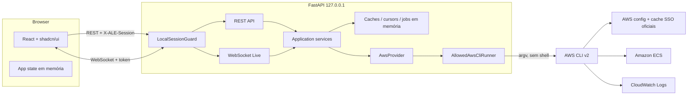
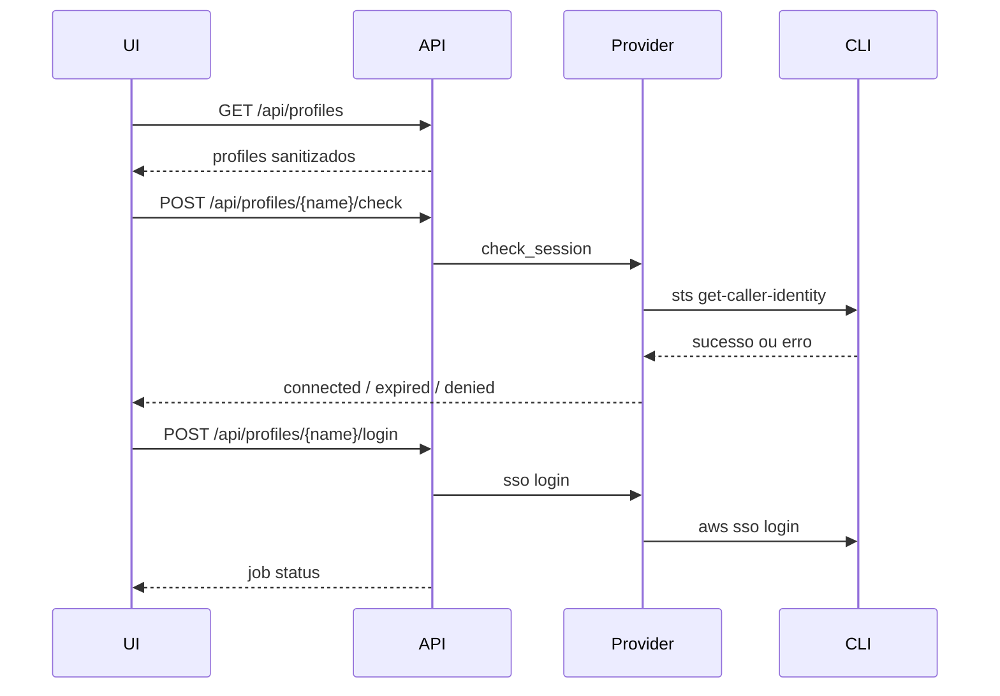
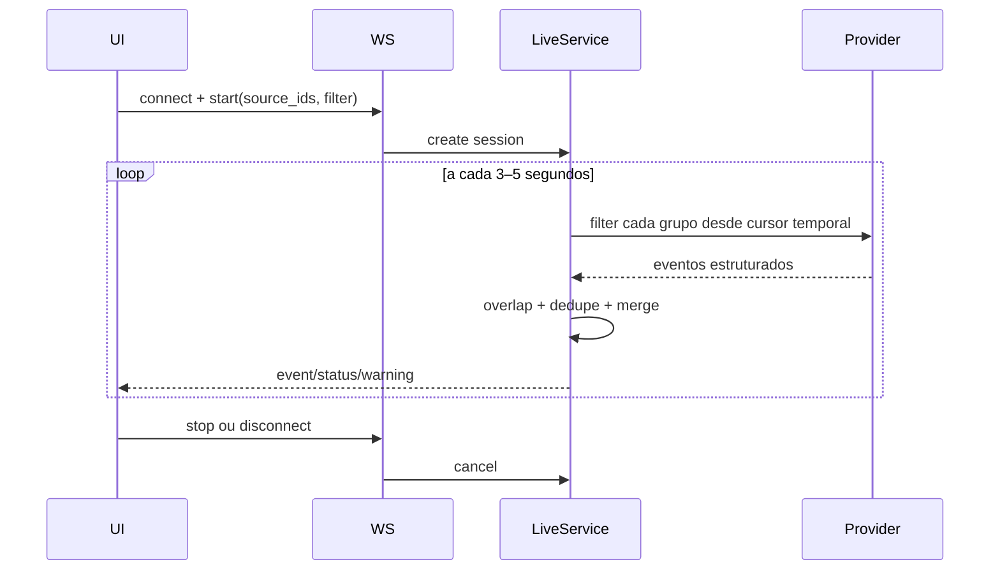

# Design — AWS Log Explorer

**Deriva de:** [`requirements.md`](requirements.md)  
**Estado:** desenho aprovado para implementação  
**Recorte:** POC local, ECS + CloudWatch Logs, AWS CLI v2

## 1. Visão geral

O AWS Log Explorer é um processo FastAPI local que serve uma SPA React e executa um subconjunto estritamente allowlisted do AWS CLI. O browser nunca executa AWS CLI, nunca lê arquivos AWS e nunca recebe credenciais. O Backend descobre profiles, valida sessão, resolve a relação ECS → task definition → container → `awslogs`, consulta eventos e entrega modelos normalizados.

A POC deve provar três jornadas completas:

1. **Autenticar e descobrir:** profile → sessão → cluster → services → fontes.
2. **Investigar histórico:** intervalo + filter pattern → busca por grupo → timeline agregada.
3. **Observar ao vivo:** WebSocket → polling estruturado → eventos deduplicados → stop/cancelamento.

Não há banco. Caches, cursores, buffers de live e jobs SSO são efêmeros e pertencem ao processo.

## 2. Objetivos e não objetivos

### Objetivos

- Reduzir cliques e contexto necessário para chegar aos logs.
- Respeitar exatamente os acessos do profile escolhido.
- Consultar várias fontes sem perder indicação de origem ou ambiguidade.
- Ser segura mesmo quando usada com profile que possua permissões além de leitura.
- Fornecer experiência de desenvolvimento e testes sem AWS real.

### Não objetivos

- Ser plataforma centralizada, multiusuário ou hospedada.
- Substituir observabilidade, tracing ou alertas.
- Inferir causalidade entre eventos.
- Armazenar, exportar ou compartilhar logs.
- Oferecer linguagem livre para produzir comandos AWS.
- Suportar fontes fora de ECS/CloudWatch no MVP.

## 3. Decisões arquiteturais

| ID | Decisão | Escolha | Motivo |
|---|---|---|---|
| D1 | Processo local | FastAPI em `127.0.0.1` servindo API + SPA | Mantém AWS CLI e arquivos locais fora do browser e permite um comando de execução |
| D2 | Integração AWS inicial | AWS CLI v2 | Reutiliza profiles e fluxo SSO já adotados pelo time |
| D3 | Fronteira AWS | `AwsProvider` | Permite trocar CLI por SDK sem alterar casos de uso ou API |
| D4 | Subprocessos | `asyncio.create_subprocess_exec` | Sem shell injection, cancelável e compatível com concorrência assíncrona |
| D5 | Histórico | `filter-log-events` por grupo | Saída JSON estruturada, filtro server-side e paginação conhecida |
| D6 | Ao vivo | polling de `filter-log-events` | Evita parser de saída humana e custo implícito de Live Tail; reusa normalização histórica |
| D7 | Estado | memória com TTL e limites | Requisito explícito de não persistir conteúdo de log |
| D8 | UI | React + Vite + Tailwind + shadcn/ui | Componentes acessíveis, consistentes e adequados para ferramenta desktop-like |
| D9 | Estado frontend | Context + `useReducer` e hooks por domínio | Escopo de tela única; evita store externa antes de necessidade comprovada |
| D10 | Segurança localhost | token efêmero + Origin/Host allowlist | Bind local sozinho não impede páginas externas de tentarem usar APIs localhost |
| D11 | Testes | provider e runner falsos | Suíte determinística, sem AWS, SSO ou dados reais |

## 4. Arquitetura



### Fronteiras

- **UI → Backend:** somente contratos HTTP/WebSocket definidos neste documento.
- **Casos de uso → AWS:** somente `AwsProvider`; casos de uso não montam argv.
- **Provider → processo:** somente `AllowedAwsCliRunner`; o provider não usa shell.
- **Runner → AWS CLI:** allowlist fechada, argumentos separados, timeout e sanitização.

## 5. Estrutura planejada

```text
aws-log-explorer/
├── README.md
├── Makefile                       # `make dev` instala locks ausentes e inicia os dois processos
├── scripts/
│   └── dev.py                     # gera token efêmero, coordena Backend/Vite e sinais
├── .gitignore
├── backend/
│   ├── pyproject.toml
│   ├── uv.lock                    # se uv for adotado; lockfile obrigatório
│   ├── src/aws_log_explorer/
│   │   ├── main.py
│   │   ├── config.py
│   │   ├── api/
│   │   │   ├── dependencies.py
│   │   │   ├── errors.py
│   │   │   ├── routes_health.py
│   │   │   ├── routes_profiles.py
│   │   │   ├── routes_ecs.py
│   │   │   ├── routes_logs.py
│   │   │   └── websocket_live.py
│   │   ├── domain/
│   │   │   ├── models.py
│   │   │   ├── errors.py
│   │   │   └── provider.py
│   │   ├── application/
│   │   │   ├── profiles.py
│   │   │   ├── discovery.py
│   │   │   ├── historical.py
│   │   │   ├── live.py
│   │   │   └── lifecycle.py
│   │   ├── infrastructure/
│   │   │   ├── aws_config.py
│   │   │   ├── cli_runner.py
│   │   │   ├── cli_provider.py
│   │   │   ├── fake_provider.py
│   │   │   └── sanitization.py
│   │   ├── security/
│   │   │   ├── local_session.py
│   │   │   ├── origins.py
│   │   │   └── command_policy.py
│   │   └── static.py
│   └── tests/
│       ├── fixtures/              # somente dados fictícios
│       ├── unit/
│       ├── integration/
│       └── contract/
├── frontend/
│   ├── package.json
│   ├── package-lock.json          # ou lockfile do gerenciador escolhido
│   ├── components.json            # shadcn/ui
│   ├── vite.config.ts
│   ├── tsconfig*.json
│   ├── src/
│   │   ├── main.tsx
│   │   ├── App.tsx
│   │   ├── api/
│   │   ├── state/
│   │   ├── hooks/
│   │   ├── components/ui/         # componentes shadcn versionados
│   │   ├── components/profiles/
│   │   ├── components/discovery/
│   │   ├── components/logs/
│   │   ├── components/layout/
│   │   ├── lib/
│   │   └── styles/globals.css
│   └── tests/
├── e2e/
│   ├── fixtures/
│   └── specs/
└── .kiro/specs/aws-log-explorer/
```

## 6. Domínio e contratos internos

### 6.1 Profiles e sessão

```python
class ProfileSummary(BaseModel):
    name: str
    region: str
    region_source: Literal["profile", "default"]
    is_sso: bool
    sso_session_key: str | None = None  # identificador interno opaco; nunca URL
    is_production: bool

class SessionCheck(BaseModel):
    profile: str
    status: Literal["connected", "expired", "denied", "error"]
    checked_at: datetime
    error: AppError | None = None

class LoginJob(BaseModel):
    id: UUID
    profile: str
    status: Literal["pending", "running", "succeeded", "failed", "cancelled", "timeout"]
    created_at: datetime
    finished_at: datetime | None = None
    error: AppError | None = None
```

`AwsConfigReader` usa `configparser`, expande o caminho com `Path.expanduser()` e respeita `AWS_CONFIG_FILE`. O response não inclui account ID, role ou URL do portal. `sso_session_key` pode ser hash process-local da seção para coordenar jobs duplicados.

`ProductionProfileClassifier` aplica, em ordem: (1) classificação automática por regex case-insensitive `(^|[-_.])(prod|prd|production)([-_.]|$)`; (2) marcação manual de proteção adicional mantida somente em memória. A marcação manual pode transformar um profile não detectado em PROD, mas nunca rebaixar um match automático. Não são usados account ID, role ou URL SSO. Testes cobrem `prd`, `team-prod`, `production.us`, falsos positivos como `product-dev` e elevação manual.

### 6.2 Descoberta ECS

```python
class ClusterView(BaseModel):
    name: str
    arn_key: str  # identificador interno; não precisa retornar ARN integral

class ServiceSummary(BaseModel):
    name: str
    cluster: str

class DescribedService(BaseModel):
    name: str
    cluster: str
    task_definition_key: str
    status: str | None = None

class LogSource(BaseModel):
    id: str
    query_key: str  # hash process-local de (region, log_group)
    service_candidates: list[str]
    service: str | None
    container_candidates: list[str]
    container: str | None
    log_group: str
    region: str
    stream_prefix: str | None
    shared: bool
```

O ID da fonte é hash estável dentro do processo sobre profile, região, cluster, grupo, container e candidatos. `query_key` é calculada somente sobre `(region, log_group)`: fontes com a mesma chave geram uma única chamada ao CloudWatch, enquanto nomes de grupo iguais em regiões diferentes permanecem consultas distintas. A UI envia IDs descobertos, nunca log group arbitrário. Um registro server-side associado à Local_Session_Token resolve ID → recurso validado.

Na normalização, cada descriptor de fonte pode produzir o prefixo esperado `<awslogs-stream-prefix>/<container>/`. Se exatamente um descriptor corresponder ao `logStreamName`, o evento recebe `service`/`container` daquela fonte; se nenhum ou vários corresponderem — inclusive quando o prefixo estiver ausente — os campos exatos ficam `None` e os arrays `service_candidates`/`container_candidates` preservam a ambiguidade.

### 6.3 Eventos e busca

```python
class NormalizedLogEvent(BaseModel):
    event_id: str
    timestamp: int
    ingestion_time: int | None
    profile: str
    region: str
    cluster: str
    service: str | None
    service_candidates: list[str]
    container: str | None
    container_candidates: list[str]
    log_group: str
    log_stream: str
    message: str
    parsed_message: dict[str, Any] | list[Any] | None = None
    shared_source: bool

class SearchRequest(BaseModel):
    profile: str
    region: str
    cluster: str
    source_ids: list[str]
    start_time: datetime
    end_time: datetime
    filter_pattern: str | None = None
    cursor: str | None = None

class SearchResponse(BaseModel):
    events: list[NormalizedLogEvent]
    cursor: str | None
    has_more: bool
    truncated: bool
    partial_errors: list[SourceError]
    ordering: Literal["approximate"] = "approximate"
```

`parsed_message` só é preenchido para JSON cujo parse resulte em objeto ou lista e permanece apenas na resposta em memória. Não é logado.

### 6.4 Erros

```python
class AppError(BaseModel):
    code: ErrorCode
    message: str
    retryable: bool
    action: Literal["login", "retry", "reload", "none"]
    details: dict[str, str | int | bool] | None = None
```

`details` é allowlisted; nunca repassa stderr bruto. O middleware retorna `{ "error": AppError }` com status coerente.

## 7. `AwsProvider`

```python
class AwsProvider(Protocol):
    async def check_session(self, profile: ProfileSummary) -> SessionCheck: ...
    async def login(self, profile: ProfileSummary, cancel: asyncio.Event) -> None: ...
    async def list_clusters(self, profile: str, region: str) -> list[ClusterView]: ...
    async def list_services(self, profile: str, region: str, cluster: str) -> list[ServiceSummary]: ...
    async def describe_services(
        self, profile: str, region: str, cluster: str, services: Sequence[str]
    ) -> list[DescribedService]: ...
    async def resolve_log_sources(
        self, profile: str, region: str, cluster: str, services: Sequence[str]
    ) -> list[LogSource]: ...
    async def filter_log_events(self, query: GroupQuery) -> GroupPage: ...
```

### Implementações

- `AwsCliProvider`: produção da POC.
- `FakeAwsProvider`: testes, E2E e demo offline; usa fixtures fictícias e relógio injetável.

O provider não conhece FastAPI e não retorna responses HTTP.

## 8. Runner seguro do AWS CLI

### 8.1 Política de comandos

A política recebe uma operação tipada, não argv livre:

```python
AwsOperation = (
    AwsVersion | StsIdentity | SsoLogin | ListClusters | ListServices |
    DescribeServices | DescribeTaskDefinition | FilterLogEvents
)
```

Cada variante possui builder próprio. A única saída é uma tupla imutável de argumentos. Allowlist final:

- `aws --version`
- `aws sts get-caller-identity`
- `aws sso login`
- `aws ecs list-clusters`
- `aws ecs list-services`
- `aws ecs describe-services`
- `aws ecs describe-task-definition`
- `aws logs filter-log-events`

Flags globais impostas pelo runner em consultas estruturadas:

- `--no-cli-pager`
- `--no-cli-auto-prompt`
- `--output json`
- `--profile <nome descoberto>`
- `--region <região validada>` quando aplicável

Flags explicitamente proibidas incluem `--no-verify-ssl`, `--endpoint-url`, `--debug`, `--unmask`, leitura de arquivo e qualquer operação não listada.

### 8.2 Execução

```python
process = await asyncio.create_subprocess_exec(
    *argv,
    stdin=DEVNULL,
    stdout=PIPE,
    stderr=PIPE,
    env=sanitized_env,
)
```

Exceção: login SSO pode herdar comportamento necessário para abrir o browser, mas continua sem shell. stdout/stderr são drenados; texto retornado à UI passa por sanitização. Em cancelamento: `terminate`, espera curta e `kill` como fallback.

### 8.3 Classificação de erros

Classificar por return code e padrões conhecidos, sem depender de uma única mensagem localizada. Prioridade:

1. executable ausente;
2. timeout/cancelamento;
3. token SSO ausente/expirado;
4. AccessDenied/Unauthorized;
5. resource not found;
6. throttling/rate exceeded;
7. validação CLI;
8. desconhecido sanitizado.

## 9. Fluxos de aplicação

### 9.1 Boot e sessão local

1. Backend gera 32 bytes aleatórios e mantém em memória.
2. Em modo integrado, o HTML recebe token em meta tag; ele não aparece em payload de API, URL, erro ou log.
3. Em desenvolvimento, `make dev` invoca `scripts/dev.py`, que instala dependências a partir dos lockfiles quando o ambiente estiver ausente, gera um token e o fornece ao Backend e ao Vite somente por variáveis dos processos filhos.
4. API client envia `X-ALE-Session` em REST.
5. WebSocket envia token no primeiro frame ou subprotocol; nunca em query string ou log.
6. Middleware valida Host (`127.0.0.1` ou `localhost`), Origin allowlisted e token com comparação constante.
7. Testes provam que token não aparece em payloads, URLs, logs, arquivos ou mensagens de erro.

### 9.2 Profile e SSO



O job não transmite output bruto. A UI recebe apenas status e mensagem segura. Polling do job a cada segundo é suficiente; WebSocket separado para login não é necessário.

### 9.3 Descoberta

1. `list-clusters` retorna nomes/keys.
2. `list-services` pagina automaticamente pelo CLI e retorna apenas `ServiceSummary` (nome e cluster).
3. Após a seleção, `describe-services` processa lotes de no máximo 10 e produz `DescribedService` com task definition/status.
4. Task definitions iguais são deduplicadas antes de `describe-task-definition`.
5. Containers sem `awslogs` são ignorados com informação por service.
6. Fontes com a mesma `(region, log_group)` compartilham `query_key`; candidatos de service/container são acumulados sem perder descriptors de prefixo.
7. Registry em memória associa `source_id` ao descriptor e `query_key` ao alvo validado.

TTL sugerido: 60 s para clusters/services e 5 min para task definitions/fontes. Alterar profile ou região invalida o escopo visual; expiração por TTL impede fonte antiga de ser usada indefinidamente.

### 9.4 Busca histórica

Para cada `query_key = (region, log_group)` única, com concorrência global 4:

1. montar query validada usando a região da chave;
2. executar `filter-log-events` uma única vez com `--max-items 500`;
3. interpretar `events` e token de continuação aceitando forma da versão suportada do CLI;
4. comparar `logStreamName` aos descriptors `<stream_prefix>/<container>/` e preencher origem exata somente quando houver um único match;
5. normalizar eventos, mantendo candidatos quando o match for ausente/ambíguo;
6. deduplicar por event ID;
7. efetuar merge ordenado;
8. retornar até 5.000 eventos, erros parciais e cursor.

O cursor retornado é UUID aleatório. O estado real fica em `CursorStore` com TTL de 15 min:

```python
class CursorState:
    request_fingerprint: str
    group_tokens: dict[str, str | None]
    exhausted_groups: set[str]
    expires_at: datetime
```

Cursor de outra Local_Session_Token, expirado ou usado com parâmetros diferentes retorna `VALIDATION_ERROR`.

### 9.5 Live



Estado por sessão:

- último timestamp por grupo;
- overlap de 2 s;
- LRU de até 20.000 event IDs;
- buffer máximo de 10.000 eventos;
- interval default 5 s;
- backoff exponencial limitado a 30 s com jitter;
- heartbeat a cada 15 s.

Frames server → client:

```json
{"type":"event","event":{}}
{"type":"status","state":"running","pollIntervalMs":5000}
{"type":"warning","code":"THROTTLED","message":"..."}
{"type":"dropped","count":120}
{"type":"error","error":{}}
{"type":"stopped","reason":"user"}
```

## 10. API local

| Método | Rota | Finalidade |
|---|---|---|
| GET | `/api/health` | processo e disponibilidade do CLI |
| GET | `/api/profiles` | profiles sanitizados |
| POST | `/api/profiles/{profile}/check` | estado da sessão |
| POST | `/api/profiles/{profile}/login` | inicia/reutiliza job SSO |
| GET | `/api/login-jobs/{id}` | acompanha login |
| DELETE | `/api/login-jobs/{id}` | cancela login |
| GET | `/api/ecs/clusters` | lista clusters |
| GET | `/api/ecs/services` | lista services do cluster |
| POST | `/api/ecs/log-sources/resolve` | resolve containers/log groups |
| POST | `/api/logs/search` | busca histórica ou continuação |
| WS | `/api/logs/live` | acompanhamento quase em tempo real |

Todos os endpoints, exceto health, exigem Local_Session_Token. Parâmetros profile/region/cluster/source são validados contra registries da sessão local.

## 11. Frontend e shadcn/ui

### 11.1 Layout

```text
┌────────────────────────────────────────────────────────────────────┐
│ AWS Log Explorer  [profile] [região] [status] [tema]               │
├──────────────────────┬─────────────────────────────────────────────┤
│ Fontes               │ Tabs: Histórico | Ao vivo                   │
│ Cluster              │ Filtros / período / filter pattern          │
│ Services             ├─────────────────────────────────────────────┤
│ Containers/grupos    │ Timeline virtualizada                       │
│ avisos compartilhado │ eventos, JSON, erros parciais, load more    │
└──────────────────────┴─────────────────────────────────────────────┘
```

Abaixo de 1024 px, fontes e filtros usam `Sheet`; timeline permanece área principal.

### 11.2 Componentes shadcn/ui

| Necessidade | Primitiva |
|---|---|
| seleção/pesquisa de profile, cluster, service | `Popover` + `Command`/combobox |
| containers e grupos | `Checkbox`, `Card`, `ScrollArea` |
| histórico/live | `Tabs` |
| filtros | `Input`, `Button`, `DropdownMenu`, date/time controls |
| estado e ambiente | `Badge`, `Alert`, `Tooltip` |
| login e confirmação PROD | `Dialog`/`AlertDialog` |
| carregamento | `Skeleton` |
| detalhes responsivos | `Sheet` |
| JSON e evento | `Collapsible` ou `Accordion`, `Card` |
| feedback | `Sonner`/toast |

Os arquivos gerados em `src/components/ui` são código do projeto. Não criar wrappers sem necessidade; componentes de domínio compõem primitivas.

### 11.3 Tema e tokens

Manter tokens semânticos shadcn (`background`, `foreground`, `primary`, `destructive`, etc.) e adicionar:

- `--service-1` a `--service-8` com pares foreground/background acessíveis;
- `--log-error`, `--log-warn`, `--log-info`, `--log-debug`;
- `--environment-prod`.

A origem também aparece em texto/ícone; cor nunca é o único canal.

### 11.4 Estado frontend

```ts
interface AppState {
  profiles: ProfileSummary[];
  activeProfile: string | null;
  session: SessionCheck | null;
  clusters: ClusterView[];
  activeCluster: string | null;
  services: ServiceSummary[];
  selectedServices: Set<string>;
  logSources: LogSource[];
  selectedSourceIds: Set<string>;
  mode: "historical" | "live";
  historical: HistoricalState;
  live: LiveState;
  localFilter: string;
}
```

Nenhum evento vai a Web Storage. Preferência de tema pode ser persistida, pois não contém log ou dado AWS; se persistida, usar somente chave de tema.

### 11.5 Timeline

- virtualizar linhas ou manter janela renderizada;
- preservar lista completa somente até cap em memória;
- timestamp em timezone local com acesso ao UTC em tooltip;
- label de Service ou “grupo compartilhado” + candidatos;
- mensagem raw sempre disponível;
- JSON formatado sob expansão;
- botão copiar por evento;
- auto-scroll somente se usuário está no final;
- ao pausar, acumular contador “N novos”.

## 12. Segurança detalhada

### Ameaças e controles

| Ameaça | Controle |
|---|---|
| site externo chama localhost | token efêmero, Origin/Host allowlist, JSON/preflight, WebSocket Origin check |
| command injection | operações tipadas, argv separado, recursos descobertos, sem shell |
| profile amplo executa escrita | allowlist fechada e testes negativos |
| output vaza identidade/segredo | descartar STS payload, sanitizar stderr, logs internos sem stdout AWS |
| log sensível fica no disco | ausência de DB/cache em disco/Web Storage/telemetria |
| processo fica órfão | registry de child processes + lifecycle shutdown |
| consulta excessiva | caps, semáforo 4, polling conservador, backoff |
| UI atribui evento ao serviço errado | shared flag + serviceCandidates + aviso explícito |

Não incluir opção de desligar TLS, endpoint customizado, debug AWS ou unmask na UI/API.

## 13. Estratégia de erros

Camadas:

1. `CliExecutionError`: interno, contém return code e buffers limitados.
2. `ProviderError`: código AWS normalizado e contexto seguro.
3. `ApplicationError`: ação recomendada e retryability.
4. `ApiError`: modelo público sanitizado.

Sanitização deve mascarar:

- sequências de 12 dígitos;
- ARNs;
- URLs `awsapps.com`;
- caminhos home;
- chaves com prefixos conhecidos;
- tokens longos/base64-like.

Logs internos devem registrar apenas operation enum, duração, status, profile alias e contagem, nunca argv completo quando puder conter filter pattern ou nomes sensíveis.

## 14. Configuração, caches e limites

### Timeouts

| Operação | Default | Faixa configurável |
|---|---:|---:|
| `aws --version` | 5 s | 1–15 s |
| STS/session check | 15 s | 5–60 s |
| descoberta ECS | 20 s | 5–120 s |
| página de logs | 30 s | 5–120 s |
| login SSO | 300 s | 60–600 s |

Overrides são configuração local do processo, validados no boot; valores fora da faixa falham cedo. Retry não pode ultrapassar o deadline total e sempre respeita cancelamento.

### Estado em memória

| Estado | Limite | TTL |
|---|---:|---:|
| clusters/services | 500 itens por chave | 60 s |
| task definitions/fontes | 1.000 itens | 5 min |
| cursor histórico | 100 cursores | 15 min |
| eventos por resposta | 5.000 | resposta |
| eventos por query key/página | 500 | página |
| query keys `(region, log_group)` | 10 | requisição |
| concorrência logs | 4 | processo |
| dedupe live | 20.000 IDs | sessão |
| buffer live | 10.000 eventos | sessão |
| live sessions | 3 locais | processo |
| login jobs | 1 por sso-session | até terminar/timeout |

Caches usam eviction determinística e são limpos no shutdown. Antes de executar uma janela de 24 h ou seleção com 10 query keys, a UI exige confirmação e cancelar o diálogo não emite chamada AWS. A UI exibe, apenas em memória, número de query keys, eventos carregados e intervalo/backoff atual; essas métricas não são enviadas externamente.

## 15. Testes

### Backend unitário

- parser de config e precedência de caminho;
- sanitização;
- command policy e builders;
- classificação de erros;
- normalização e merge;
- shared groups;
- cursor TTL/fingerprint;
- overlap e dedupe live;
- cancelamento e lifecycle.

### Backend integração

Usar fake executable/runner, nunca AWS real:

- profiles + status;
- login job success/failure/cancel;
- descoberta paginada;
- search com página vazia + token;
- partial errors;
- WebSocket events/stop/disconnect;
- token/origin/host inválidos.

### Frontend

Vitest + Testing Library + MSW/fake:

- tema e acessibilidade básica;
- profile expirado → login → conectado;
- seleção de múltiplos services/fontes;
- shared group warning;
- busca histórica/load more;
- JSON/raw/copy/local filter;
- live pause/resume/stop/dropped;
- erros agrupados e ações.

### E2E

Provider fake ativado explicitamente por ambiente de teste:

1. boot;
2. selecionar profile fictício;
3. autenticar fake;
4. selecionar cluster e dois services;
5. consultar histórico;
6. carregar mais;
7. iniciar live e receber evento;
8. pausar/retomar;
9. parar;
10. confirmar ausência de erro e processo pendente.

### Smoke AWS real

Opt-in, fora da suíte padrão, somente após autorização:

- `aws --version`;
- listar profiles sanitizados;
- session check;
- listar clusters/services em `dev`;
- resolver fontes sem buscar mensagens;
- uma busca com janela mínima e limite baixo, sem salvar output;
- repetir metadados em `hml`; produção apenas depois de confirmação específica.

## 16. Observabilidade local

Somente métricas efêmeras e logs operacionais:

- duração por operação;
- contagem de chamadas;
- eventos retornados;
- throttling/retry;
- processos ativos;
- live sessions ativas.

Proibido registrar mensagens, filter patterns, stdout de STS, account IDs, ARNs ou URLs SSO. Sem telemetria externa.

## 17. Build e execução

- Backend gerenciado por `pyproject.toml` e lockfile.
- Frontend com dependências exatas e lockfile.
- `make dev` é o bootstrap canônico: cria/atualiza ambientes somente a partir dos lockfiles quando necessário e então chama `scripts/dev.py` para iniciar Backend e Vite com token local compartilhado apenas por ambiente de processo.
- `make setup` pode preparar dependências sem iniciar, mas não é obrigatório antes de `make dev`.
- `make build` compila frontend para diretório servido pelo FastAPI.
- `make start` executa modo integrado já compilado em `127.0.0.1`.
- `make test` roda testes backend, frontend e E2E fake para feedback rápido; smoke AWS não faz parte desse comando.
- `make check` é o gate único e executa, em ordem, testes backend/frontend/E2E fake, lint, typecheck e build limpo; smoke AWS continua separado e opt-in.

O Backend deve falhar cedo e com mensagem clara se os estáticos não estiverem compilados no modo integrado.

## 18. Critérios de aceite arquiteturais

Antes de declarar a POC pronta:

1. busca textual no repositório não encontra `shell=True`, `create_subprocess_shell`, `os.system`, operações AWS de escrita ou `--unmask` fora de testes negativos/documentação;
2. testes provam allowlist fechada;
3. fechamento de WebSocket e shutdown deixam zero tarefas/processos registrados;
4. frontend build é servido pelo FastAPI;
5. eventos não aparecem em arquivos gerados, snapshots, storage ou logs do processo;
6. um segundo desenvolvedor executa o fluxo pelo README;
7. limitações de shared groups e ordenação aproximada estão visíveis na UI.
